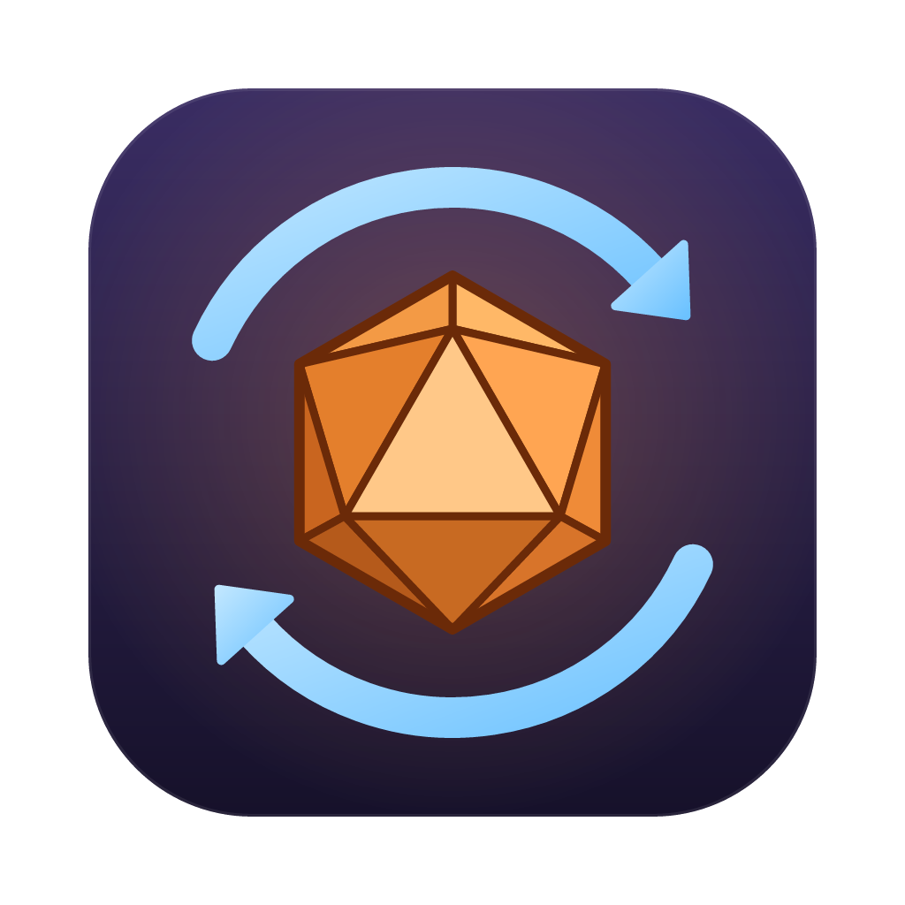

<p align="center">
  
</p>

<h1 align="center">FoundryVTT Backup</h1>

<p align="center">
  Back up and restore your <a href="https://foundryvtt.com">Foundry VTT</a> worlds to a cloud-synced folder, and keep them in sync between your computers.<br/>
  macOS · Windows · Linux
</p>

---

## What it does

- **Back up everything:** each world, plus your installed **modules, game systems and assets** (everything in Foundry's `Data` folder). Backups are `.zip` files in a folder you choose, for example in Dropbox, OneDrive, iCloud Drive, Google Drive, Nextcloud or Syncthing.
- **Continue on another PC:** click **Restore all newer** there and you get the worlds plus every module and system. Nothing needs to be installed by hand.
- **Open Foundry user data folder:** one click opens Foundry's `Config`/`Data`/`Logs` folder in Finder or Explorer.
- **Restore** the latest backup, or any older one, with one click. It works on another PC too, even if the world doesn't exist there yet.
- **Shows the dates:** when each world last changed on this PC, and when and on which PC each backup was made.
- **Sync status per world:** *Up to date*, *Local changes*, *Newer backup* (from another PC), *Conflict*, *Not on this PC*, *No backup yet*.
- **Safe:**
  - Refuses to back up or restore a world that is open in Foundry.
  - Writes backups as `*.partial` first, so your cloud client never syncs half a file.
  - Saves a local safety copy of your world before every restore.
  - Rejects zips with unsafe paths.
- **Keeps the last N backups** per world (configurable, 0 = keep all).
- Remembers both folders between launches.

## Download

Get the file for your OS from the [latest release](https://github.com/Grimgorg/foundryvtt-backup/releases/latest):

| OS | File |
|---|---|
| Windows 10/11 | `FoundryVTT-Backup_<ver>_windows_x64_portable.exe`: single file, just run it. Or use the `-setup.exe` installer. |
| macOS (Apple Silicon & Intel) | `FoundryVTT.Backup_<ver>_universal.dmg` |
| Linux | `FoundryVTT.Backup_<ver>_amd64.AppImage` (`chmod +x`, then run), or the `.deb` |

> The builds are not code-signed yet.
> **macOS:** right-click the app → *Open* → *Open* the first time, or run `xattr -cr "/Applications/FoundryVTT Backup.app"`.
> **Windows:** if SmartScreen appears, click *More info → Run anyway*.

## How to use

1. **Backup folder:** click *Choose…* and pick a folder inside your cloud drive, e.g. `Dropbox/FoundryBackups`. Use the same folder on every PC.
2. **Foundry worlds folder:** it is found automatically on first start (*Auto-detect*). Default locations:
   - macOS: `~/Library/Application Support/FoundryVTT/Data/worlds`
   - Windows: `%LOCALAPPDATA%\FoundryVTT\Data\worlds`
   - Linux: `~/.local/share/FoundryVTT/Data/worlds`

   If you use a custom Foundry data path, it is read from `Config/options.json`, or you can choose the folder by hand.
3. **Close the world in Foundry** (return to setup), then click **Back up now** or **Back up all**.
4. On your other PC, wait for the cloud sync, open the app and click **Restore latest**.

### Backup folder layout

```
<backup folder>/
  my-world/
    my-world__2026-11-24T09-30-00Z__Gaming-PC.zip
    my-world__2026-11-23T18-02-11Z__MacBook.zip
```

The file name holds the world id, the time in UTC and the PC name. Each zip has the world under `my-world/` plus a small `fvtt-backup.json` manifest. You can unzip it by hand into `Data/worlds` if you ever need to.

### Good to know

- **Modules, systems & assets** form one backup, `_foundry-data` in the backup folder. Restoring it replaces those folders in `Data` and never touches your worlds. The previous folders are kept in `Data-before-restore` next to `Data`, which you can reach with *Open Foundry user data folder*.
- Foundry's `Config` folder (license key, server settings) is **not** synced, because it belongs to each PC.
- Use the same Foundry version on every PC.
- Safety copies made before a restore are kept locally (last 5 per world). Find them via the *Safety copies* link at the bottom of the app.
- The sync status is remembered per PC. The first time, before you have backed up or restored on a PC, it is estimated from file dates and shown with a `?`.

## Build from source

See [BUILD_PLAN.md](BUILD_PLAN.md). Short version:

```bash
npm install
npm run tauri dev     # run
npm run tauri build   # build for your OS
```

## License

[MIT](LICENSE): free for everyone to use, change and share.

This project is not affiliated with or endorsed by Foundry Gaming LLC. "Foundry Virtual Tabletop" is a trademark of Foundry Gaming LLC.
